# 인증/인가 : 401/403 처리

> 관련 노트: [Session vs JWT](./session-vs-jwt.md) · [전역 에러 처리](../error-handling/global-error-handling.md)

## 401 Unauthorized

- 인증 실패 (토큰 없음, 만료, 유효하지 않음) / `Access Token`이 만료된 경우에 발생
- `Access Token`이 만료되면 `Refresh Token`으로 `Access Token`을 재발급 받은 후 실패한 요청을 다시 실행
- 동시에 여러 요청이 실패하면 재발급은 한 번만 진행, 재시도 또한 한 번만 진행
- `Refresh Token`까지 만료되어 재발급에 실패하면 사용자 상태를 초기화하고, 원래 보던 페이지 경로와 함께 로그인 페이지로 보냄

## 403 Forbidden

- 사용자가 누구인지는 알지만 권한은 없는 경우에 발생
- `Token`을 재발급하거나 재시도해도 결과는 같음
- 재시도를 하지 않고 `"접근 권한이 없습니다."` 같은 메시지나 페이지를 보여주고 홈이나 이전 페이지로 이동시킴

## 공통 처리

- `Axios` 인터셉터 같은 공통 레이어에서 일괄적으로 처리
- `TanStack Query`의 `retry` 옵션에서 401/403은 제외시킴

## 토큰 저장 위치

- `Refresh Token`은 `httpOnly + Secure + SameSite 쿠키`에 저장 (JS 접근을 막아 XSS 탈취 위험을 줄이고, `SameSite`로 CSRF를 방어)
- `Access Token`은 `Zustand` 같은 메모리 상태에 저장하고, 새로고침으로 사라지면 서비스 시작 시 `Refresh Token`으로 다시 발급 받음
- 저장 위치별 보안 차이는 [Session vs JWT](./session-vs-jwt.md#보안-및-저장-위치) 참고
