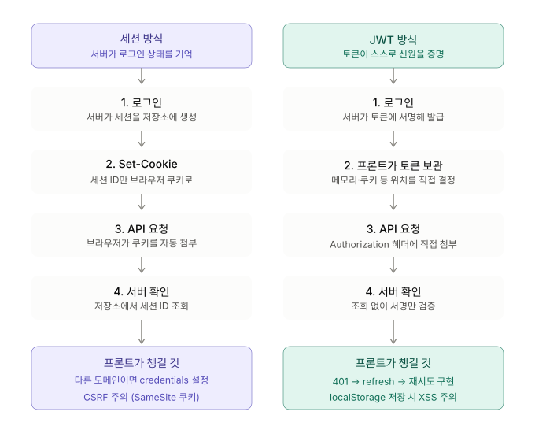

# Session vs JWT

> 관련 노트: [인증/인가 : 401/403 처리](./authentication-authorization.md)

## 세션 방식

1. 로그인하면 서버가 세션을 만들어 서버 메모리나 `Redis` 같은 저장소에 보관
2. 서버는 그 세션의 `ID`만 `Set-Cookie`로 브라우저에 보내줌 (ex. `sessionId=abc123`)
3. 이후 요청마다 브라우저가 쿠키를 자동으로 붙여서 보내줌
4. 서버는 `ID`로 저장소를 조회해서 해당 사용자가 맞는지 확인

- API 서버가 다른 도메인이면 쿠키가 자동으로 붙지 않음
  - `fetch`는 `credentials: 'include'`, `Axios`는 `withCredentials: true` 설정 필요
  - 서버도 `Access-Control-Allow-Credentials: true`로 응답해야 함

## JWT 방식

1. 로그인하면 서버가 사용자 정보(ID, 권한, 만료시간)를 담은 서명된 토큰을 발급
2. 프론트에서 토큰을 저장해 두었다가 요청마다 `Authorization: Bearer <token>` 헤더에 직접 붙임
3. 서버는 저장소를 조회하지 않고 서명만 검증. 토큰 자체가 신분증 역할을 함

- 한 번 발급한 토큰은 만료 전까지 서버에서 무효화하기 어려움
  - `Access Token`의 만료 시간을 짧게 잡고 `Refresh Token`으로 재발급 받는 방식으로 보완

## 보안 및 저장 위치

- `localStorage`에 `JWT`를 저장하면 JS로 접근이 가능해서 `XSS`에 취약함
- `HttpOnly` 쿠키는 JS로 읽지 못해서 `XSS`로 접근은 어렵지만 `CSRF`를 신경 써야 함
  - `SameSite=Lax/Strict`나 `CSRF 토큰`으로 방어
- 실무에서는 보통 이렇게 나눠서 사용
  - `Access Token` → 메모리(`state`)
  - `Refresh Token` → `HttpOnly` 쿠키
- 새로고침하면 메모리가 날아가기 때문에 앱 시작 시 `refresh`로 `Access Token`을 다시 받아와야 함

## 언제 써야 하나?

| 방식 | 적합한 상황 |
| --- | --- |
| 세션 | 단일 웹서비스, 서버를 하나만 사용하는 경우, 즉시 로그아웃이나 강제 만료가 중요한 경우 |
| JWT | 모바일 앱과 웹이 같은 API를 사용하는 경우, 서버가 여러 대이거나 MSA라 세션 공유가 번거로운 경우, 외부 서비스와 인증을 주고받는 경우 |

## Next.js에서는?

- `NextAuth`는 DB 어댑터가 없으면 기본적으로 `JWT`를 암호화하여 `HttpOnly` 쿠키에 담는 방식을 사용
- DB 어댑터를 연결하면 세션을 DB에 저장하는 방식이 기본값이 됨
- 즉 **"JWT이지만 쿠키로 저장한다"** 를 구분해야 함

> **핵심 정리**
> - 세션 vs JWT → **"상태를 서버에서 가지느냐"** 의 문제
> - 쿠키 vs 헤더 → **"어떻게 전달하느냐"** 의 문제
>
> 두 축을 분리해서 생각하기!
