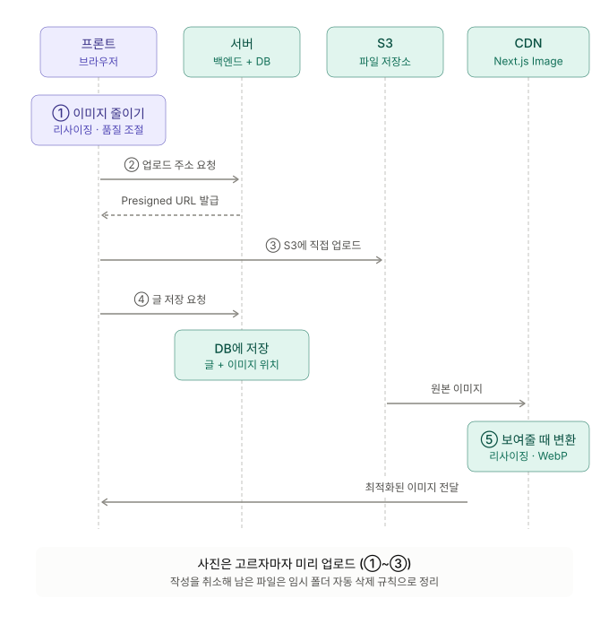

# 이미지 압축하는 방법

- 프론트에서 이미지를 줄이고 `Presigned URL`로 `S3`에 올리는 것이 일반적
- `Next.js Image` 컴포넌트나 `CDN`을 쓰면 `WebP` 변환을 프론트에서 할 필요 없이, 이미지를 보여줄 때 처리됨

## 프론트에서 줄이는 방법

- `canvas`에 이미지를 작게 그린 뒤 `toBlob`으로 포맷과 품질을 지정해서 꺼냄 (ex. `canvas.toBlob(callback, 'image/jpeg', 0.8)`)
- 직접 구현하지 않고 `browser-image-compression` 같은 라이브러리를 쓰는 경우가 많음
- 최대 가로 길이와 용량 상한을 미리 정해 두고, 그보다 큰 이미지만 줄임

## 업로드 흐름

1. 이미지가 너무 크면 프론트에서 크기를 줄임 (리사이징 / 품질 조절)
2. 서버에 이미지 저장 요청을 하면, 서버가 권한 확인 후 몇 분 동안 쓸 수 있는 `Presigned URL`을 줌
3. 받은 주소로 프론트가 `S3`에 직접 업로드 (서버를 거치지 않음)
4. 업로드 완료를 서버에 알리면 서버가 이미지 파일 위치를 `DB`에 저장. 알리는 방식은 아래 셋 중 하나를 선택
   - 업로드 완료 후 프론트가 API를 호출해서 알리기
   - 이미지만 따로 알리지 않고, 게시글·프로필 등을 저장할 때 한 번에 요청
   - `S3`가 직접 서버에 알려주기 (이벤트 알림)
5. 이미지를 보여줄 때 `Next.js Image`나 `CDN`이 화면 크기에 맞게 줄이고 `WebP`로 변환해서 보내줌

## 미리 업로드와 정리

- 글 저장을 기다리지 않고 사진을 고르자마자 1~3단계를 미리 진행하면, 저장 버튼을 눌렀을 때 기다리는 시간이 줄어듦
- 작성을 취소하면 `S3`에 쓰지 않는 파일이 남음
  - 임시 폴더에 먼저 올리고, 글이 저장되면 정식 위치로 옮김
  - 임시 폴더에 남은 파일은 `S3` 수명 주기 규칙으로 자동 삭제
